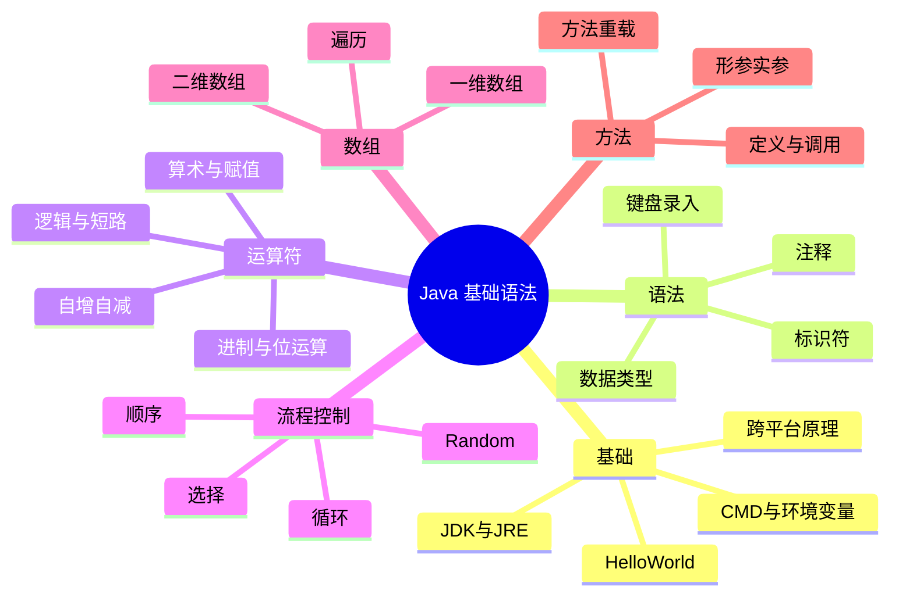

>[!NOTE] 关于本文
> 本文是笔者 **忘痕** 在 B 站学习 Java基本语法 课程后整理的笔记与代码练习，内容主要来自课程讲解，仅作学习交流，如有疏漏欢迎指正；文章排版与可读性由 **DeepSeek-V4.1-Flash** 协助做了优化。
# 📖 本文导读

这是一篇从零开始的 Java 入门笔记,覆盖从"装好 JDK、跑出第一个 HelloWorld"到"会写方法、能摆弄数组"的全部基础。全文按下面的顺序推进:

| 章节 | 内容 |
|---|---|
| 一、Java基础 | CMD 命令、环境变量、JDK 是什么、第一个程序、跨平台原理 |
| 二、Java基础语法 | 注释、数据类型、标识符、键盘录入、IDEA 的层级结构 |
| 三、运算符 | 算术、赋值、比较、逻辑、自增自减、进制与位运算 |
| 四、流程控制语句 | 顺序、选择(if / switch)、循环(for / while / do-while)、Random |
| 五、数组 | 一维 / 二维数组的定义、初始化、访问与遍历 |
| 六、方法 | 方法的定义与调用、形参与实参、方法重载 |

> [!TIP] 怎么读最省劲
> 前三章(基础、语法、运算符)是"看懂语法",重点在**理解**而不是背;第四章之后的 if / 循环 / 数组 / 方法,建议**边看边敲**,每个例子自己跑一遍。
> 文中的代码都是能直接运行的片段,看不懂时先照着敲,报错了也是在学习。

---
# 一、Java基础

> [!NOTE] 这一章解决三件事
> ① 让电脑能"找到"Java(`CMD` 命令行、环境变量);② 搞明白 `JDK` / `JRE` / `JVM` 是什么关系;③ 跑出第一个 `HelloWorld`,顺便理解 Java 为什么能跨平台。

## 1\.常用CMD命令

|操作|说明|
|---|---|
|`盘符名称:`|盘符切换。E:回车，表示切换到E盘|
|`dir`|查看当前路径下的内容|
|`cd 目录`|进入单级目录。cd itheima|
|`cd ..`|回退到上一级目录|
|`cd 目录1\目录2...`|进入多级目录。cd itheima\\JavaSE|
|`cd \`|回退到盘符目录|
|`cls`|清屏|
|`exit`|退出命令提示符窗口|

## 2\.环境变量

> [!TIP] 为什么要配环境变量
> 不配的话,你只能在程序所在的那个目录里敲命令;配进 `Path` 之后,**任何目录下系统都能找到它**。
> 就像给快递员一张地址表:没有地址表,每次都得你亲自带路;有了地址表,他在哪儿都能送到。
> 注意查找顺序:`CMD` 会**先找当前目录,再按 `Path` 从上往下找**,所以越常用的路径越往上放。

在软件启动包所在目录下输入软件启动包的名字如idea64\.exe就可以启动idea软件。

如果想要在CMD的任意目录下，都可以启动某一个软件，那么就可以把这个软件的路径配置到环境变量中的PATH里面：

1. 右键我的电脑，选择属性

2. 点击左侧的高级系统设置

3. 选择高级，再点击下面的环境变量

4. 找系统变量里面的PATH

5. 把软件的完整路径，配置到Path当中就可以了

6. 就是把自己配置的路径，移动到最上面（可做可不做）

> 在CMD中打开软件时，会先找当前路径，再找环境变量，在环境变量中是从上往下依次查找的，如果路径放在最上面查找的速度比较快。

## 3\.Java概述

### 3\.1 JRE和JDK

> [!IMPORTANT] 三个东西的包含关系（从大到小）
> **JDK ⊃ JRE ⊃ JVM**:JDK = 开发工具 + JRE;JRE = JVM + 核心类库;JVM = 真正负责"运行"的虚拟机。
> 一句话记:**写代码要 JDK,跑代码要 JRE,跨平台靠 JVM。** 安装时装 JDK 就行,另外两个它都带着。

JVM（Java Virtual Machine），Java虚拟机

JRE（Java Runtime Environment），Java运行环境，包含了JVM和Java的核心类库（Java API）

JDK（Java Development Kit）称为Java开发工具，包含了JRE和开发工具

### 3\.2 JDK下载与安装

官网：

[http://www.oracle.com/]()

解压安装包`jdk-17_windows-x64_bin.exe`一直下一步就可以了，但是安装路径尽量不要有中文和空白字符。

### 3\.3 JDK的安装目录

|目录名称|说明|
|---|---|
|bin|该路径下存放了JDK的各种工具命令。javac和java就放在这个目录。|
|conf|该路径下存放了JDK的相关配置文件。|
|include|该路径下存放了一些平台特定的头文件。|
|jmods|该路径下存放了JDK的各种模块。|
|legal|该路径下存放了JDK各模块的授权文档。|
|lib|该路径下存放了JDK工具的一些补充JAR包。|

## 4\.HelloWorld小案例

> [!TIP] 两个命令别搞混
> `javac HelloWorld.java` 是**编译**,产出 `HelloWorld.class`;`java HelloWorld` 是**运行**,执行那个 class。
> 两个大坑:① 文件名必须和 `public class` 后面的类名**完全一致**(含大小写);② 运行 `java` 时**不带** `.class` 后缀。

1. 创建一个文件`HelloWorld.java`文件：

```Java
public class HelloWorld {
        public static void main(String[] args) {
                System.out.println("HelloWorld");
        }
}
```

1. 在所在目录下打开cmd窗口

2. 运行指令`javac HelloWorld.java`和`java HelloWorld`

    - javac \+ 文件名 \+ 后缀名 （就是编译java文件，编译后会产生一个\.class文件）

    - java \+ 文件名（运行编译之后的class文件）

**注意**：

执行javac和java指令需要先配置环境变量：

①**JAVA\_HOME**：告诉操作系统JDK安装在了哪个位置（未来其他技术要通过这个找JDK）


②**Path**：告诉操作系统JDK提供的javac\(编译\)、java\(执行\)命令安装到了哪个位置


## 5\.Java语言的发展

Java有很多版本，其中三个最重要的版本：

- Java5\.0：这是Java的第一个大版本更新。

- Java8\.0：这个是目前绝大数公司正在使用的版本。因为这个版本最为稳定。

- Java15\.0：这个是我们课程中学习的版本。

高版本的Java完全兼容低版本的Java，但是低版本的Java不一定兼容高版本的Java。

**Java的三大平台**：

JavaSE：其他两个版本的基础

JavaME：Java语言的小型版，用于嵌入式消费类电子设备或者小型移动设备的开发。

JavaEE：用于Web方向的网站开发。（主要从事后台服务器的开发）

## 6\.Java语言跨平台的原理

- 操作系统本身其实是不认识Java语言的。

- 但是针对于不同的操作系统，Java提供了不同的虚拟机。

虚拟机会把Java语言翻译成操作系统能看得懂的语言。


# 二、Java基础语法

> [!NOTE] 这一章在准备"词汇表"
> 注释、数据类型、标识符、键盘录入,都是后面所有代码的原材料。内容不难,但**细节很多**,建议对着代码多敲几遍。

## 1\.注释

> [!TIP] 三种注释各管一段
> - `//` 单行注释:日常最常用,写在代码旁边或上方
> - `/* */` 多行注释:临时把一段代码"注释掉"
> - `/** */` 文档注释:写在类 / 方法上,能被 `javadoc` 提取成 API 文档
> 注意:**多行注释不能嵌套多行注释**,否则第一个 `*/` 就提前闭合了;但可以嵌单行注释。

1. 单行注释

```Java
// 这是单行注释文字
```

2. 多行注释

```Java
/*
这是多行注释文字
这是多行注释文字
这是多行注释文字
*/
```

3. 文档注释

|标签|描述|
|---|---|
|@author|表示作者|
|@deprecated|标识过期的类或成员|
|@exception|标识抛出的异常|
|@param|标识方法的参数|
|@return|标识方法的返回值|
|@see|标识指定参数的内容|
|@serial|标识序列化属性|
|@version|标识版本|
|@throws|标识引入一个特定的变化|

```Java
/**
 * @author 黑马程序员
 * @version v1.0
 */
```

**注意**：多行注释不能嵌套多行注释，但是可以嵌套单行注释。

## 2\.数据类型

> [!NOTE] 为什么要搞出这么多种类型
> 本质是在**内存占用**和**取值范围**之间做取舍:数字越大,占的地方越多。日常写代码 `int` 和 `double` 就够用,只有明确需要时才用 `byte` / `long`。
> 两个绕不开的小写后缀:定义 `long` 要加 `L`,定义 `float` 要加 `F`——因为 `10` 默认是 int、`1.5` 默认是 double。

java的数据类型分为基本数据类型和引用数据类型。

四类八种基本数据类型：

| 数据类型   | 关键字     | 内存占用 | 取值范围                                    |
| ------ | ------- | ---- | --------------------------------------- |
| 整数<br> | byte    | 1    | 负的2的7次方 \~ 2的7次方\-1\(\-128\~127\)       |
|        | short   | 2    | 负的2的15次方 \~ 2的15次方\-1\(\-32768\~32767\) |
|        | int     | 4    | 负的2的31次方 \~ 2的31次方\-1                   |
|        | long    | 8    | 负的2的63次方 \~ 2的63次方\-1                   |
| 浮点数    | float   | 4    | 1\.401298e\-45 \~ 3\.402823e\+38        |
|        | double  | 8    | 4\.9000000e\-324 \~ 1\.797693e\+308     |
| 字符     | char    | 2    | 0\-65535                                |
| 布尔     | boolean | 1    | true，false                              |

**注意点**：

- byte的范围：\-128\~127

- 整数类型和小数类型的取值范围大小关系：double \> float \> long \> int \> short \> byte

- 如果要定义一个long类型的变量，那么在数据值的后面需要加上L后缀（大小写都可以，建议大写）

- 如果要定义一个float类型的变量，那么在数据值的后面需要加上F后缀（大小写都可以）

**数据类型的选择**：

- 如果要定义 一个整数类型的变量，不知道选择哪种数据类型了，默认使用int

- 如果要定义 一个小数类型的变量，不知道选择哪种数据类型了，默认使用double

- 如果要定义一个long类型的变量，那么在数据值的后面需要加上L后缀（大小写都可以，建议大写。）

- 如果要定义一个float类型的变量，那么在数据值的后面需要加上F后缀（大小写都可以）

## 3\.标识符

> [!TIP] 硬性要求 vs 约定俗成
> **硬性要求**(不满足直接编译不过):只能由字母、数字、`_`、`$` 组成;数字不能开头;不能是关键字;区分大小写。
> **命名习惯**(不满足也能跑,但会被同事嫌弃):类名用**大驼峰** `HelloWorld`,变量和方法用**小驼峰** `firstName`。

### 3\.1 硬性要求

必须要这么做，否则代码会报错：

- 必须由数字、字母、下划线`_`、美元符号`$`组成

- 数字不能开头

- 不能是关键字

- 区分大小写的

### 3\.2 软件建议

#### 3\.2\.1 小驼峰命名法

适用于变量名和方法名：

- 如果是一个单词，那么全部小写，比如：name

- 如果是多个单词，那么从第二个单词开始，首字母大写，比如：firstName、maxAge

#### 3\.2\.2 大驼峰命名法

适用于类名：

- 如果是一个单词，那么首字母大写。比如：Demo、Test

- 如果是多个单词，那么每一个单词首字母都需要大写，比如：HelloWorld

#### 3\.2\.3 阿里巴巴命名规范细节

1. 尽量不要用拼音，但是一些国际通用的拼音可视为英文单词

2. 平时在给变量名、方法名、类名起名字的时候，不要使用下划线或美元符号

## 4\.键盘录入

> [!NOTE] 键盘录入是死套路，三步走
> ① 导包 `import java.util.Scanner;` ② 创建 `Scanner sc = new Scanner(System.in);` ③ 取值 `sc.nextInt()`。
> 换个类型就换个方法:`nextInt()` 读整数、`nextDouble()` 读小数、`next()` 读一个单词、`nextLine()` 读一整行。

1\.导包：找到类所在位置

```Java
import java.util.Scanner;
```

2\.创建对象

```Java
Scanner sc = new Scanner(System.in);
```

3\.接收数据：以接受整数为例

```Java
int inputStr = sc.nextInt();
```

## 5\.IntelliJ IDEA

IntelliJ IDEA是Java语言开发的集成环境，它把代码的编写，编译，执行，调试等多种功能综合到一起，从而简化开发流程。

### 5\.1 安装

官网：

[https://www.jetbrains.com/idea]()

1. 双击资料中的安装包，点击next，准备安装（可以修改文件的安装路径）

2. 勾选64\-bit launcher（其他的不要勾选），表示在桌面新建一个64位的快捷方式

3. 点击Install（选择JetBrains），准备安装

4. 等进度条读取完毕之后，会有最终界面提示，点击finish即可

破解版安装步骤参考资料中的视频（2022版本）

### 5\.2 IDEA中层级结构

> [!TIP] 用"公司"理解这四层
> **Project(项目)= 公司;Module(模块)= 部门;Package(包)= 小组;Class(类)= 工位。**
> 所以真正的代码永远写在最里层的 `class` 里;找类的路径就是"公司 → 部门 → 小组 → 工位"。

**结构分类**：

- project（项目、工程）

- module（模块）

- package（包）

- class（类）

**project（项目、工程）**：淘宝、京东、黑马程序员网站都属于一个个项目，IDEA中就是一个个的Project。

**module（模块）**：在一个项目中，可以存放多个模块，不同的模块可以存放项目中不同的业务功能代码，微信的微信、通讯录、发现等都可以是一个模块。

**package（包）**：一个模块中又有很多的业务，比如微信模块的聊天功能就可以是一个包。

**class（类）**：就是真正写代码的地方。

> project中可以创建多个module，module中可以创建多个package，package中可以创建多个class。

# 三、运算符

> [!NOTE] 运算符其实就是"动词"
> 这一章看着零碎,其实只有两类:**算术运算**(`+ - * / %`,算出结果)和**逻辑判断**(`> < == &&`,算出 true / false)。
> 后面所有的 if、循环条件,归根到底都是逻辑运算的结果。

## 1\.算数运算符

```Java
+ - * :跟小学数学中一模一样没有任何区别；
    
/：整数相除结果只能得到商，如果结果想要小数，必须要有小数参与运算（一个或两个）。
    
%：取模、取余。只能对整数操作，取两个数相除的余数。
```

**技巧**：

1. 判断整数a是否是偶数：

a%2，结果为0表示a是偶数，结果是1表示a是奇数。

2. 获取任意一个整数a上每一位数：

个位：a % 10

十位：a / 10 % 10

百位：a / 100 % 10

千位：a / 1000 % 10

\.\.\.\.\.\.以此类推

## 2\.自增自减运算符

> [!IMPORTANT] `a++` 和 `++a` 只差一个"先后"
> - `a++`:**先用** a 的值,再 +1
> - `++a`:**先 +1**,再用 a 的值
> 单独写一行 `a++;` 时两者没区别;只有参与赋值或运算时才看得出差别,比如 `int b = a++;` 和 `int b = ++a;` 的结果不同。

```Java
++  自增运算符
--  自减运算符
```

**a\+\+和\+\+a的区别**：

```Java
a++是先使用a，再进行++运算。
++a是先进行++运算，再使用a。
```

## 3\.扩展赋值运算符

\+=、\-=、\*=、/=、%=

就是把左边跟右边进行运算，把最终的结果赋值给左边，对右边没有任何影响。

**注意点**：

扩展的赋值运算符中隐层还包含了一个强制转换，比如 `a += b ;`实际上相当于 `a = (byte)(a + b);`

## 4\.关系运算符

|符号|解释|
|---|---|
|==|就是判断左边跟右边是否相等，如果成立就是true，如果不成立就是false|
|\!=|就是判断左边跟右边是否不相等，如果成立就是true，如果不成立就是false|
|\>|就是判断左边是否大于右边，如果成立就是true，如果不成立就是false|
|\>=|就是判断左边是否大于等于右边，如果成立就是true，如果不成立就是false|
|\<|就是判断左边是否小于右边，如果成立就是true，如果不成立就是false|
|\<=|就是判断左边是否小于等于右边，如果成立就是true，如果不成立就是false|

关系运算符最终的结果一定是布尔类型的，结果要么是true，要么是false。

## 5\.逻辑运算符

\&：逻辑与（而且），两边都为真，结果才是真，只要有一个为假，那么结果就是假。

\|：逻辑或（或者），两边都为假，结果才是假，只要有一个为真，那么结果就是真。

^：异或，如果两边相同，结果为false，如果两边不同，结果为true。

！：取反，false取反就是true，true取反就是false。

## 6\.短路逻辑运算符

> [!TIP] `&` 和 `&&` 的差别，以及它为什么能"保命"
> `&` 两边都会执行;`&&` 在左边为 false 时**右边直接不执行**(就是"短路"),`|` 和 `||` 同理。
> 好处是能避免报错,例如 `if (str != null && str.length() > 0)`:左边为 null 时右边不执行,否则早就抛 `NullPointerException` 了。

分类： \&\& \|\|

当左边不能确定整个表达式的结果，右边才会执行。

当左边能确定整个表达式的结果，那么右边就不会执行了。从而提高了代码的运行效率。

## 7\.三元运算符

格式：`关系表达式 ？ 表达式1 ：表达式2`

三元运算符的最终结果一定要被使用，要么赋值给一个变量，要么直接打印出来。

## 8\.隐式转换

自动类型提升，即把一个取值范围小的数据或者变量，赋值给另一个取值范围大的变量。此时不需要我们额外写代码单独实现，是程序自动帮我们完成的。例如`long a = 10;`，int型常量10自动转换成long型赋值给变量a。

**两种提升规则**：

- 取值范围小的，和取值范围大的进行运算，小的会先提升为大的，再进行运算

- byte、short、char三种类型的数据在运算的时候，都会直接先提升为int，然后再进行运算

- ***取值范围从小到大的关系***：byte \< short \< int \< long \< float \< double

## 9\.强制转换

> [!WARNING] 强转是把大杯子的水倒进小杯子
> `int b = (int) 12.9;` 得到的是 **12**——小数部分直接被砍掉,不是四舍五入;超出范围时还会得到一个莫名其妙的负数。
> 所以强转前先问自己:**这个值真的放得下吗?** 想要四舍五入就用 `Math.round(12.9)`。

如果要把一个取值范围大的数据或者变量赋值给另一个取值范围小的变量。是不允许直接操作，需要用到强制类型转换。

**语法**：

```Java
目标数据类型 变量名 = （目标数据类型）被强转的数据；

例如：double a = 12.3;
     int b = (int) a;
```

**注意**：强制转换有可能会导致数据发生错误。（数据的精度丢失）

## 10\.字符串相关操作

字符串的\+操作：如果加操作出现了字符串，那么后面的加都会拼接成一个字符串（字符串加操作之前的加不受影响）。例如`1 + 2 + "abc" + 2 + 1`，结果为`3abc21`。

字符的\+操作：当\+操作中出现了字符，会拿着字符到计算机内置的ASCII码表中去查对应的数字，然后再进行计算。例如`'a' + 1`的结果为`98`。

## 11\.原码、反码和补码

> [!NOTE] 为什么非要搞出"补码"
> 因为计算机**只会做加法,不会做减法**。原码算负数会出错,反码跨 0 会差 1,补码正好把这两个问题都解决了——**把减法变成加一个负数**,而且 0 只有一种表示。
> 结论:计算机里**存储和计算用的都是补码**,原码 / 反码只是为了把原理讲清楚。

### 11\.1 原码

十进制数据的二进制表现形式，最左边是符号位，0为正，1为负，

利用原码对正数的计算不会出错。

原码的弊端：但如果是负数计算，结果会出错，结果和预期相反。

### 11\.2 反码

为了解决不能计算负数的问题而存在

正数的反码不变，负数的反码在原码的基础上，符号位不变，数值取反，0变1，1变0\.

反码的弊端：负数运算时，如果结果不跨0，结果没问题，如果结果跨0，就会跟实际结果有1的偏差。

### 11\.3 补码

为了解决负数计算时跨0的问题而出现的。

正数的补码不变，负数的补码在反码的基础上\+1。

另外，补码还能多记录一个特殊值\-128，该数据在1个字节下，没有原码和反码。

**注意点**：计算机中的存储和计算都是以补码的形式进行的。

#### 11\.3\.1 隐式转换底层原理

- 正数：在前面补0，符号位保持为0

- 负数：在前面补1，但符号位保持不变

#### 11\.3 2 强制转换底层原理

- 去掉前面的高位，截取后剩下的第一位作为符号位

## 12\.位运算符

> [!TIP] 位运算的两个实用结论
> - 左移 n 位 = 乘 2 的 n 次方;右移 n 位 = 除以 2 的 n 次方(向下取整)
> - 位运算直接在补码上操作,比乘除法**快得多**,所以 JDK 源码里经常能见到 `<<`

|运算符|含义|运算规则|
|---|---|---|
|\&|逻辑与|0为false 1为true|
|\||逻辑或|0为false 1为true|
|\<\<|左移|向左移动，低位补0|
|\>\>|右移|向右移动，高位补0或1|
|\>\>\>|无符号右移|向右移动，高位补0|

- 这些运算符都是针对补码操作的

- **左移一次相当于乘2，右移一次相当于除2**

## 13\.运算符的优先级

在Java中涉及了很多的运算符，每一种运算符都有各自的优先级。但是这些优先级不需要记忆，只要知道**小括号优先于所有**即可。

# 四、流程控制语句

> [!NOTE] 程序从"一条直线"变成"会拐弯"
> 顺序结构是默认行为;`if` / `switch` 让程序**选路**;`for` / `while` 让程序**重复**。这三样凑齐,基本就能写出任何逻辑。

## 1\.顺序结构

最基本的流程控制，没有特定的语法结构，按照代码的先后顺序，依次执行，程序中大多数的代码都是这样执行的。

## 2\.判断和选择结构

### 2\.1 if语句

#### 2\.1\.1 格式1

```Java
if (关系表达式) {
    语句体;        
}
```

如果关系表达式为true，就执行语句体，否则跳过if语句。

**细节**：

1. 如果要对一个布尔类型的变量进行判断，不要写==，直接把变量写在小括号中即可。

2. 如果大括号中的语句体只有一条，那么大括号可以省略不写

> [!WARNING] 大括号省略了，`if` 只管最近的一条语句
> 只有一条语句时大括号可以省,但省略后 `if` **只控制紧挨着它的那一条**。比如 `if (a > 0) System.out.println("正"); System.out.println("结束");` —— 第二句永远都会执行。
> 所以建议:**能不省就不省**,少一个 bug 来源。

**建议**：

1. 大括号还是不要省略

```Java
int a = 100; //相当于两条语句：1.定义变量a 2.给变量a赋值为100
```

3. 大括号的开头可以另起一行书写，但是建议写在第一行的末尾

#### 2\.1\.2 格式二

```Java
if (关系表达式) {
    语句体1;        
} else {
    语句体2;        
}
```

如果关系表达式为true，执行语句体1，否则，执行语句体2。

#### 2\.1\.3 格式三

```Java
if (关系表达式1) {
    语句体1;        
} else if (关系表达式2) {
    语句体2;        
} 
…
else {
    语句体n+1;
}
```

如果关系表达式1为true，执行语句体1，否则如果关系表达式2为true，执行语句体2，\.\.\.，所有关系表达式都为false才执行语句体n\+1。

### 2\.2 switch语句

> [!WARNING] 忘写 `break` 是 switch 最常见的 bug
> 某个 case 少写 `break`,程序会**继续往下执行所有 case**(不再判断条件),这就是 **case 穿透**。
> 它偶尔有用(多个条件共用一段逻辑),但绝大多数时候是漏写。JDK 12 之后可以用 `case 1, 2 -> ...` 的箭头写法,它**自带 break**,不会穿透。

```Java
格式：
switch (表达式) {
        case 1:
                语句体1;
                break;
        case 2:
                语句体2;
                break;
        ...
        default:
                语句体n+1;
                break;
}
```

首先计算出表达式的值，然后和case依次比较，一旦有对应的值，就会执行相应的语句，在执行的过程中，遇到break就会结束；如果所有的case都和表达式的值不匹配，就会执行default语句体部分，然后程序结束掉。

**细节**：

- default可以放在任意位置，建议放在最后

- switch 不支持 long、float、double、boolean 等类型，如果需要处理这些类型，可以使用 if\-else 语句

- **case穿透**：不写break会引发case穿透现象，即下面所有case语句都会执行（不会判断下面case的值），知道遇到break为止，例如：

```Java
//输出2 3 4 -1    
public static void main(String[] args) {
        int a = 2;
        switch (a) {
            case 1:
                System.out.println(1);
                break;
            case 2:
                System.out.println(2);
            case 3:
                System.out.println(3);
            case 4:
                System.out.println(4);
            default:
                System.out.println(-1);
                break;
        }
    }
```

- switch在JDK12的新特性：

```Java
// -> 自带break
switch (week) {
    case 1, 2, 3, 4, 5 -> System.out.println("工作日");
    case 6, 7 -> System.out.println("休息日");
    default -> System.out.println("没有这个星期");
}
```

## 3\.循环结构

### 3\.1 for循环

```Java
for (初始化语句;条件判断语句;条件控制语句) {
        循环体语句;
}
```

**执行流程**：

① 执行初始化语句

② 执行条件判断语句，看其结果是true还是false

- 如果是false，循环结束

- 如果是true， 执行③

③ 执行循环体语句

④ 执行②

**细节**：初始化语句只执行一次，其中定义的变量只在本for循环内存在。

**练习**：求和连续的自然数之和

```Java
public class ForTest02 {
    public static void main(String[] args) {
                //存放求和结果
                int sum = 0;
                for(int i=1; i<=5; i++) {
                        sum = sum + i; //累加
                }
                //打印求和结果
                System.out.println("1-5之间的数据和是：" + sum);
    }
}
```

### 3\.2 while循环

```Java
while(条件判断语句){
        循环体;
        条件控制语句;
}
```

**执行流程**：先判断条件判断语句，为true就执行循环体和条件控制语句，之后返回条件判断语句，\.\.\.，直到条件判断语句为false位置结束循环。

**练习**：一张纸折叠多少次厚度能超过珠穆朗玛峰的高度

```Java
int height = 8844430; //珠穆朗玛峰高度
double paper = 0.1; //纸张厚度

int count = 0; //计数器，统计折叠次数

while(paper < height){
    //折叠纸张
    paper = paper * 2;
    count++;
}

//4.打印一下纸张的厚度
System.out.println(count);//27
```

### 3\.3 do\.\.\.while循环

```Java
do{
    循环体;
    条件控制语句;
}while(条件判断语句);
```

**执行流程**：和while循环一致，只是会先执行循环体和条件控制语句再执行条件判断语句。

### 3\.4 三种格式的区别

> [!TIP] 到底该用哪个循环
> - 知道**循环几次**(遍历数组、1 到 100):用 `for`
> - 不知道几次,只知道**什么时候停**(比如"折纸超过珠峰"):用 `while`
> - 想**先执行一次**再判断(比如先弹一次输入):用 `do...while`
> 补充:`for` 里定义的变量出了循环就不存在了,这是它和 `while` 的一个实际差别。

- for和while循环，是先判断，再执行

- do\.\.\.while是先执行，再判断

当知道循环次数或者循环范围的时候，用for循环；

当不知道循环次数，也不知道循环范围，但是知道循环的结束条件时，用while循环

### 3\.5 循环高级

#### 3\.5\.1 无限循环

又叫死循环。循环一直停不下来。

**for格式**：

```Java
for(;;){
    System.out.println("循环执行一直在打印内容");
}
```

**while格式**：

```Java
while(true){
    System.out.println("循环执行一直在打印内容");
}
```

**do\.\.\.while格式**：

```Java
do{
    System.out.println("循环执行一直在打印内容");
}while(true);
```

**注意事项**：

- 最为常用的格式：while

- 无限循环下面不能再写其他代码了，因为永远执行不到

#### 3\.5\.2 条件控制语句

> [!NOTE] `break` 和 `continue` 的分工
> - `break`:直接**跳出**当前循环 / switch
> - `continue`:跳过本次,**进入下一次**循环
> 小坑:循环里套着 switch 时,switch 里的 `break` 只跳出 switch,跳不出外层循环;要跳出去就给循环起个名字(如 `loop:`),再用 `break loop;`。

**break**：不能单独存在，可以用在switch和循环中，表示结束本次switch或循环语句。

**continue**：不能单独存在，只能存在于循环当中。表示跳过本次循环，继续执行下次循环。

**细节**：如果循环中含有switch语句，则switch语句中的break会结束switch语句，而不是整个循环，如果希望跳出整个循环，需要为循环设置别名，例如：

```Java
Scanner sc = new Scanner(System.in);
int number;
loop: //为循环起别名loop
    while (true) {
        System.out.println("请输入一个数字(0结束循环)：");
        number = sc.nextInt();
        switch (number) {
            case 0:
                break loop; //输入0结束死循环loop
            case 1:
                System.out.println("一");
                break; //跳出switch语句
            case 2:
                System.out.println("二");
                break; //跳出switch语句
            case 3:
                System.out.println("三");
                break; //跳出switch语句
            default:
                System.out.println("输入数字太大");
                break; //跳出switch语句
        }
    }
```

## 4\.Random

Random类是实现随机数生成的。

1. 导包

```Java
import java.util.Random;
导包的动作必须出现在类定义的上边。
```

2. 创建对象

```Java
Random r = new Random ();
上面这个格式里面，只有r是变量名，可以变，其他的都不允许变。
```

3. 生成随机数

```Java
int number = r.nextInt(随机数的范围);
上面这个格式里面，只有number是变量名，可以变，其他的都不允许变。
随机数范围的特点：从0开始，不包含指定值。比如：参数为10，生成的范围[0,10)
技巧：[a,b]表示为r.nextInt(b - a + 1) + a
```

# 五、数组

> [!NOTE] 数组到底是什么
> 一块**连续的内存**,用来装**同一种类型**的多个值。正因为连续,按下标取值特别快——后面所有集合类都建立在这个思想上。
> 两个固定事实:下标**从 0 开始**;长度用 `数组名.length`(是字段不是方法,**不加括号**)。

一种容器，可以同来存储同种数据类型的多个值。

## 1\.一维数组

### 1\.1 数组的定义

**格式一**：

```Java
数据类型[] 数组名

例如：
int[] array
```

**格式二**：

```Java
数据类型  数组名[]

例如：
int array[]
```

方法括号跟数组名，谁写在前面，谁写在后面都是一样的。平时习惯性使用第一种方式。

### 1\.2 数组的初始化

#### 1\.2\.1 静态初始化

**完整格式**：

```Java
数据类型[] 数组名 = new 数据类型[]{元素1，元素2，元素3，元素4...};

例如：
int[] arr = new int[]{11,22,33};
```

方括号中，多个元素之间一定要用逗号隔开。

**简化格式**：

```Java
数据类型[] 数组名 = {元素1，元素2，元素3，元素4...};

例如：
int[] array = {1,2,3,4,5};
```

#### 1\.2\.2 动态初始化

**格式**：

```Java
数据类型[] 数组名 = new 数据类型[数组的长度];

例如：
int[] agesArr = new int[3];
```

**数组的默认初始化值**：

- 整数类型：0

- 小数类型：0\.0

- 布尔类型：false

- 字符类型：'\\u0000'

- 引用类型：null

#### 1\.2\.3 两种初始化方式的区别

> [!TIP] 静态还是动态，看"数据你知不知道"
> - **数据都知道** → 静态初始化:`int[] arr = {1, 2, 3};`
> - **只知道要几个、不知道具体值** → 动态初始化:`int[] arr = new int[5];`(系统给默认值:整数 0、小数 0.0、布尔 false、引用 null)

静态初始化：手动指定数组的元素，系统会根据元素的个数，计算出数组的长度。

动态初始化：手动指定数组长度，由系统给出默认初始化值。

**使用场景**：

- 只明确元素个数，但是不明确具体的数据，推荐使用动态初始化

- 已经明确了要操作的所有数据，推荐使用静态初始化

### 1\.3 地址值

> [!NOTE] 为什么打印数组会出来 `[I@6d03e736`
> 这不是乱码,是**数组在内存里的地址**。拆开看:`[` 表示一维数组,`I` 表示元素是 int,`@` 只是分隔符,后面是十六进制地址。
> 想看内容得用 `Arrays.toString(arr)`(一维)或 `Arrays.deepToString(arr)`(二维)。

数组的本质就是内存中一段连续的存储空间，**数组的值就是这个连续存储空间的地址**。打印数组的时候，实际出现的是数组的地址值：

```Java
int[] arr = {1,2,3,4,5};
System.out.println(arr);//[I@6d03e736
```

- \[ ：表示现在打印的是一个数组

- I：表示现在打印的数组是int类型的

- @：仅仅是一个间隔符号而已

- 6d03e736：就是数组在内存中真正的地址值（十六进制的）

我们习惯性会把`[I@6d03e736`这个整体称之为数组的地址值。

### 1\.4 数组元素访问

**索引**：

数组的每个元素都有其对应的索引：

1. 索引一定是从0开始的

2. 索引是连续不间断的

3. 索引逐个\+1增长

例如：上面定义的arr，1的索引为0，2的索引为1，\.\.\. ，以此类推。

**格式**：

```Java
数组名[索引];
```

**作用**：

- 获取数组中对应索引上的值。例如arr\[2\]就获取到了3

- 修改数组中对应索引上的值，一旦修改，原来的值就会被覆盖，无法恢复。例如`arr[2] = 2;`，就修改了arr\[2\]，以后访问到的arr\[2\]都表示2，而不是3

### 1\.5 数组的遍历

遍历：就是把数组里面所有的内容一个一个全部取出来。

数组的长度：`数组名.length`

通用代码：

```Java
for(int i = 0; i < arr.length; i++){
    //在循环的过程中，i依次表示数组中的每一个索引
    System.out.println(arr[i]);//就可以把数组里面的每一个元素都获取出来，并打印在控制台上了。
}
```

## 2\.二维数组

二维数组的本质还是一维数组，只是数组的每一个元素是一个一维数组的地址值，而二维数组也是一个地址值。

二维数组的操作和一维数组很类似，但也有不同，这里只介绍不同地方。

### 2\.1 初始化

#### 2\.1\.1 静态初始化

**格式**：

```Java
数据类型[][] 数组名 = new 数据类型[][]{{元素1, 元素2, ...},{元素1, 元素2, ...},...}

例如：
int[][] arr=new int[][]{{11, 22},{33, 44, 55}}
```

**简化格式**：

```Java
数据类型[][] 数组名 = {{元素1, 元素2, ...},{元素1, 元素2, ...},...}

例如：
int[][] arr={{11, 22},{33, 44, 55}}
```

- 二维数组的每一个一维数组长度不一定一致

#### 2\.1\.2 动态初始化

**格式**：

```Java
数据类型[][] 数组名 = new 数据类型[m][n];

例如：
int[][] arr=new int[2][3]
```

- m表示这个二维数组可以存放多少个一维数组

- n表示每一个一维数组可以存放多少个元素

- 这个时候二维数组的每一个一维数组长度必须一致

### 2\.2 数组元素访问

```Java
arr[0]可以获取二维数组arr中的第一个一维数组，本身是一个地址。

arr[0][0]可以获取二维数组arr中的第一个一维数组中的第一个元素，本身是一个值。
```

通过赋值运算符可以进行赋值，赋值后二维数组那个位置的值将不存在，会被新值替代。

### 2\.3 遍历二维数组

`arr.length`可以获得二维数组arr包含几个一维数组，不能获得二维数组arr最多存几个元素。

二维数组中存的实际上是每一个一维数组的地址值。

```Java
int[][] arr = {{1, 2, 3}, {5, 6, 7, 8}};
for (int i = 0; i < arr.length; i++) {
    for (int j = 0; j < arr[i].length; j++) {
        System.out.println(arr[i][j]);
    }
}
```

# 六、方法

> [!NOTE] 方法就是"给一段代码起个名字"
> 好处有三个:复用(写一次调多次)、可读(名字说明意图)、好维护(改一处都生效)。它和 C 的函数、Python 的 `def` 是一个概念。
> 记忆点:**必须先定义再调用**,方法体不调用就不会执行。

方法（method）是程序中最小的执行单元，**必须先定义才能调用**，类似c语言中的函数。

## 1\.方法的定义与调用

### 1\.1 无参数方法定义和调用

**定义**：

```Java
public static void 方法名 () {
        // 方法体;
}

例如：
public static void method () {
        System.out.println("我是一个method方法");
}
```

**调用**：

```Java
方法名();

例如：
method();
```

### 1\.2 带参数方法定义和调用

**定义**：

参数：由数据类型和变量名组成，多个参数间用逗号隔开： `数据类型 变量名;`

参数范例：`int a;`

```Java
public static void 方法名 (参数1) {
        方法体;
}
public static void 方法名 (参数1, 参数2, 参数3...) {
        方法体;
}

例如：
public static void isEvenNumber(int number){
    ...
}
public static void getMax(int num1, int num2){
    ...
}
```

**调用**：

方法调用时，参数的数量与类型必须与方法定义中的设置相匹配。

```Java
方法名(参数)；
方法名(参数1,参数2);

例如：
isEvenNumber(10);
getMax(10,20);
```

#### 形参和实参

1. 形参：方法定义中的参数，等同于变量定义格式，例如：number、num1、num2

2. 实参：方法调用中的参数，等同于使用变量或常量，例如： 10、20

### 1\.3 带返回值方法的定义和调用

**定义**：

方法定义时return后面的返回值与方法定义上的数据类型要匹配。

```Java
public static 数据类型 方法名 ( 参数 ) { 
        return 数据 ;
}

例如：
public static boolean isEvenNumber( int number ) {           
        return true ;
}
public static int getMax( int a, int b ) {
        return a > b ? a : b;
}
```

**调用**：

方法的返回值通常会使用变量接收，否则该返回值将无意义。

```Java
方法名 ( 参数 ) ;
数据类型 变量名 = 方法名 ( 参数 ) ;

例如：
isEvenNumber ( 5 ) ;
boolean  flag =  isEvenNumber ( 5 ); 
```

### 1\.4 方法的通用格式

```Java
public static 返回值类型 方法名(参数) {
   方法体; 
   return 数据 ;
}
```

- 返回值类型可以任意，但是必须和return的结果类型一致（引用数据类型也可以不一致，这里牵扯到多态，后面讲）

- 方法名推荐使用小驼峰命名，见名知意

- 参数可以是0个、1个、多个，但必须包含数据类型和变量名

- 如果返回值类型是void，return语句可以省略

### 1\.5 方法的注意事项

- 方法不能嵌套定义，否则会引发编译错误\!\!\!

- void表示无返回值，可以省略return，也可以单独的书写return，后面不加数据

## 2\.方法重载

> [!IMPORTANT] 判断是不是重载，只看三点
> ① 在同一个类里;② **方法名相同**;③ **参数不同**(类型 / 个数 / 顺序)。
> **与返回值无关**——返回值不同但参数一样,不叫重载,还会直接编译报错。

**方法重载概念**：方法重载指同一个类中定义的多个方法之间的关系，满足下列条件的多个方法相互构成重载：

1. 多个方法在同一个类中

2. 多个方法具有**相同的方法名**

3. 多个方法的**参数不相同**，即类型不同、数量不同或顺序不同

**注意事项**：

- 重载仅对应方法的定义，与方法的调用无关

- 重载仅针对同一个类中方法的名称和参数（形参），而和返回值无关（返回值可以不同）

**例如**:下面的两个 `compare` 方法同名、参数类型不同,就构成了重载

```Java
//int
public static boolean compare(int a, int b) {
    System.out.println("int");
    return a > b;
}

//long
public static boolean compare(long a, long b) {
    System.out.println("long");
    return a > b;
}
```

# ✅ 总结一下

## 一图流回顾



## 六章一句话

| 章节 | 一句话 |
| --- | --- |
| 一、Java基础 | 配好环境、装好 JDK,跑出第一个 HelloWorld |
| 二、Java基础语法 | 注释、数据类型、标识符、键盘录入——写代码的"原材料" |
| 三、运算符 | 算术算结果、逻辑算真假,一切条件判断的起点 |
| 四、流程控制 | 让程序会选路(if / switch)、会重复(for / while) |
| 五、数组 | 一块连续内存装同类型数据,下标从 0 开始 |
| 六、方法 | 给一段代码起名字,先定义后调用,参数不同即为重载 |

## 最容易踩的几个坑

> [!WARNING] 新手高频错误
> - **文件名 ≠ 类名**:`public class HelloWorld` 必须存成 `HelloWorld.java`,大小写敏感
> - **`java` 命令不带后缀**:是 `java HelloWorld`,不是 `java HelloWorld.class`
> - **`long` 忘加 `L`、`float` 忘加 `F`**:编译直接报错
> - **`switch` 漏写 `break`**:引发 case 穿透
> - **`a++` 与 `++a` 混用**:参与运算时结果不一样
> - **数组下标越界**:长度为 5 的数组,最大下标是 4
> - **强转丢精度**:`(int) 12.9` 得到 12,不是 13

## 两条值得记住的规律

> [!TIP] 记住这两条，少写一半 bug
> 1. **小类型转大类型是自动的,大转小必须强转**:`byte < short < int < long < float < double`;而 `byte`、`short`、`char` 参与运算时会**先自动提升成 int**。
> 2. **条件判断要"先短路、再取值"**:用 `&&` / `||` 保护可能为 null 的对象,两个条件写反了就会抛 `NullPointerException`。

> [!NOTE] 最后
> 这一篇内容看起来很散,其实是一条线:**先让程序能跑(环境 + HelloWorld),再让程序会表达(数据类型 + 运算符),最后让程序会思考(流程控制 + 数组 + 方法)。**
> 把这根线记住,比背下每个语法点有用得多。
