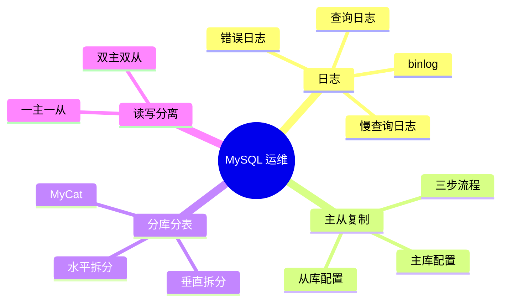

> [!NOTE] 关于本文
> 本文是笔者 **忘痕** 在 B 站学习 MySQL 运维课程后整理的笔记与代码练习，内容主要来自课程讲解，仅作学习交流，如有疏漏欢迎指正；文章排版与可读性由 **DeepSeek-V4.1-Flash** 协助做了优化。

# 📖 本文导读

这是「MySQL 运维」的实操笔记:前半部分讲**怎么让数据库稳定运转**(日志、主从复制、分库分表),后半部分讲**怎么扛住更大的流量**(读写分离)和几个实用补充。文中的配置步骤**大量以截图呈现**,建议对照截图一步步操作。

| 章节 | 一句话概括 |
|---|---|
| 十四、日志 | 数据库的「行车记录仪」:出错看错误日志、恢复靠 binlog、调优看慢查询 |
| 十五、主从复制 | 主库的改动自动同步到从库,主库挂了能顶上,读请求可以分担 |
| 十六、分库分表 | 单表/单机撑不住时,把数据拆到多台机器,用 MyCat 当统一入口 |
| 十七、读写分离 | 写操作给主库、读操作给从库,各干各的活 |
| 十八、补充内容 | 权限表速查 + 两个日常小技巧 |

> [!TIP] 建议的阅读顺序
> 第一次接触的话,先看**十四、日志**和**十五、主从复制**——这两章是地基,理解了"binlog 能重放"和"从库照着抄",后面的分库分表、读写分离就顺理成章了。
> 第十六章篇幅最长(几乎占正文一半)。如果只想弄懂"为什么拆、按什么规则拆",看 1~3 节 + 5.3 的分片规则总览即可,具体配置用到再回来查。

> [!NOTE] 三个绕不开的名词，先混个脸熟（看不懂也没关系，下文都会展开）
> - **binlog（二进制日志）**：数据库的「操作录像」，把每一次**改数据**的动作按顺序记下来，需要时照着重放一遍——**备份恢复**和**主从复制**都靠它。
> - **主从复制**：主库把「我改了什么」写进 binlog，从库照着执行一遍，于是一台库变成好几台内容一样的库。
> - **分库分表**：一张表/一台机器装不下时，按规则把数据拆到多台机器上；再架一个 MyCat 这样的**中间件**，让程序仍然只连一个地址。

---

# 十四、日志

> [!NOTE] 先建立地图：MySQL 有四种日志，管的事完全不同
> - **错误日志**：启动、停止、严重故障的记录 → **出问题第一个看它**
> - **二进制日志（binlog）**：记录所有**改数据**的操作 → 用于**数据恢复**和**主从复制**
> - **查询日志**：记录客户端发来的**所有语句**（包括 select）→ 调试用，平时关着
> - **慢查询日志**：只记录**执行时间超标**的 SQL → 性能调优的起点
>
> 一句话记：**出故障看错误日志，丢了数据看 binlog，想优化看慢查询日志。**

## 1\.错误日志

> [!TIP] 简单来说
> 它像数据库的「病历本」：什么时候启动、什么时候挂掉、报了什么错，都记在上面。所以遇到"起不来、莫名其妙断开"这类问题，**第一件事就是去看它**。
> 默认路径 `/var/log/mysqld.log`（Windows 一般在安装目录 `data` 下、以计算机名命名）。找不到位置就用下面这条命令查。

错误日志是 MySQL 中最重要的日志之一，它记录了当 mysqld 启动和停止时，以及服务器在运行过程中发生任何严重错误时的相关信息，当数据库出现任何故障导致无法正常使用时，建议首先查看此日志。

该日志是默认开启的，默认存放目录 /var/log/，默认的日志文件名为 mysqld\.log 。

查看日志位置：

```SQL
show variables like '%log_error%'; -- log_error
```

## 2\.二进制日志

### 2\.1 介绍

> [!IMPORTANT] 简单来说：binlog 记的是「怎么改的」，不是「查了什么」
> `insert/update/delete`、建表改表它都记；`select` 不记（只读不改，记了也没用）。
> 所以它天生适合干两件事：**① 数据恢复**——误删了数据，用它把那段操作重放回来；**② 主从复制**——从库照着 binlog 再执行一遍，数据就同步了。
> MySQL 8.0 默认就开着它，这也是"误删了还能救"的前提。

二进制日志\(BINLOG\)记录了所有的 DDL\(数据定义语言\)语句和 DML\(数据操纵语言\)语句，但不包括数据查询\(SELECT、SHOW\)语句。

作用：

1. 灾难时的数据恢复

2. MySQL的主从复制

在MVSOL8版本中，默认二进制日志是开启着的，涉及到的参数如下：

```SQL
show variables like '%log_bin%' -- log_bin
```


### 2\.2 日志格式

> [!TIP] 三种格式怎么选（一句话版）
> - **statement**：记"你执行的那句 SQL"→ 文件小；但 `now()`、`uuid()` 这类函数重放时结果可能不一样，**主从可能不一致**
> - **row**：记"每一行数据变成了什么样"→ 文件大一点，但**最精确最安全**，是默认值
> - **mixed**：让 MySQL 自己挑（平时用 statement，遇到不安全的语句自动切 row）
>
> 结论：**要主从可靠、要恢复准确，就用 row。**

MySQL服务器中提供了多种格式来记录二进制记录，具体格式及特点如下：

|日志格式|含义|
|---|---|
|statement|基于SQL语句的日志记录，记录的是SQL语句，对数据进行修改的SQL都会记录在日志文件中。|
|row|基于行的日志记录，记录的是每一行的数据变更。\(默认\)|
|mixed|混合了STATEMENT和ROW两种格式，默认采用STATEMENT，在某些特殊情况下会自动切换为ROW进行记录。|

查看参数方式

```SQL
show variables like '%binlog_format%'; -- binlog_format
```

修改参数

```SQL
set binlog_format = statement|row|mixed;
```

### 2\.3 日志查看

> [!NOTE] 简单来说
> binlog 是二进制文件，直接 `cat` 出来是乱码，得用 **mysqlbinlog** 这个「播放器」把它翻译成一条条可读的 SQL 语句再看。

由于日志是以二进制方式存储的，不能直接读取，需要通过二进制日志查询工具 mysqlbinlog 来查看。

```Properties
mysqlbinlog [参数选项] logfilename

参数选项：
    -d    指定数据库名称，只列出指定的数据库相关的操作。
    -o    忽略掉日志中的前n行命令。
    -v    将行事件(数据变更)重构为SOL语句。
    -w    将行事件(数据变更)重构为SQL语句，并输出注释信息
```

### 2\.4 日志删除

> [!WARNING] `reset master` 一定要慎用
> 它会把**所有** binlog 删光，并把编号重置成 `binlog.000001`。如果这台机器配了主从复制，从库还等着按旧文件名和位点来同步，这一步会让**从库直接找不到日志而中断**。
> 只想删一部分，用 `purge master logs to / before`；长期方案是设置过期时间（`binlog_expire_logs_seconds`），到点自动清理。

对于比较繁忙的业务系统，每天生成的binlog数据巨大，如果长时间不清除，将会占用大量磁盘空间。可以通过以下几种方式清理日志：

|指令|含义|
|---|---|
|`reset master;`|删除全部 binlog 日志，删除之后，日志编号将从 binlog\.000001重新开始|
|`purge master logs to ``'``binlog.***``'``;`|删除 \*\*\* 编号之前的所有日志|
|`purge master logs before ``'``yyyy-mm-dd hh24:mi:ss``'``;`|删除日志为”yyyy\-mm\-dd hh24:mi:ss”之前产生的所有日志|

也可以在mysql的配置文件中配置二进制日志的过期时间，设置了之后，二进制日志过期会自动删除\.

```SQL
show variables like '%binlog_expire_logs_seconds%'; -- binlog_expire_logs_seconds
```

设置过期时间

```SQL
set global binlog_expire_logs_seconds = seconds;
```

## 3\.查询日志

> [!TIP] 什么时候才开它
> 想知道"到底是谁在执行什么 SQL"（排查可疑操作、复盘接口行为）时才开。它会把**每条语句**都写下来，常年开着很占磁盘也影响性能，**查完记得关**。

查询日志中记录了客户端的所有操作语句，而二进制日志不包含查询数据的SQL语句。默认情况下，查询日志是未开启的。如果需要开启查询日志，可以设置一下配置：

修改MySQL的配置文件my\.cnf或my\.ini 文件，添加如下内容：

```Properties
#该选项用来开启查询日志，可选值：0或者1；0代表关闭，1代表开启
general_log=1
#设置日志的文件名，如果没有指定，默认的文件名为 host_name.log
general_log_file=mysql_query.log
```

## 4\.慢查询日志

> [!IMPORTANT] 它是 SQL 调优的起点
> 优化 SQL 不能靠猜，得靠它把"跑得慢的语句"抓出来。标准流程：
> **打开慢查询日志 → 找出最慢的几条 → 用 `explain` 看执行计划 → 加索引 / 改写法**
> `long_query_time` 默认 10 秒，实际项目建议调到 1~2 秒，否则一天的慢 SQL 可能一条都抓不到。

慢查询日志记录了所有执行时间超过参数 long\_query\_time 设置值并且扫描记录数不小于 min\_examined\_row\_limit 的所有的SQL语句的日志，默认未开启。long\_query\_time 默认为 10 秒，最小为0，精度可以到微秒。

```Properties
#慢查询日志
slow_query_log=1
#执行时间参数
long_query_time=2
```

默认情况下，不会记录管理语句，也不会记录不使用索引进行查找的查询。可以使用log\_slow\_admin\_statements和更改此行为log\_queries\_not\_using\_indexes

```Properties
#记录执行较慢的管理语句
log_slow_admin_statements = 1
#记录执行较慢的未使用索引的语句
log_queries_not_using_indexes = 1
```

# 十五、主从复制

> [!NOTE] 简单来说：主从复制就是「主库写作业，从库照着抄」
> 主库负责写，它把每次改动记进 binlog；从库拿到这份 binlog，在自己的数据上再执行一遍，两边就一致了。
> 有了它才能做三件事：**主库挂了切到从库（高可用）**、**读请求分给从库（分担压力）**、**在从库上备份（不影响主库）**。

## 1\.概述

主从复制是指将主数据库的DDL 和 DML 操作通过二进制日志传到从库服务器中，然后在从库上对这些日志重新执行（也叫重做），从而 使得从库和主库的数据保持同步。

MySQL支持一台主库同时向多台从库进行复制， 从库同时也可以作为其他从服务器的主库，实现链状复制。

MySQL 复制的主要特点包含以下三个方面：

1. 主库出现问题，可以快速切换到从库提供服务

2. 实现读写分离，降低主库的访问压力

3. 可以在从库中执行备份，以避免备份期间影响主库服务


## 2\.原理

> [!TIP] 三步背下来
> **① 主库写 binlog** → **② 从库的 IO 线程把 binlog 抄成 relay log（中继日志）** → **③ 从库的 SQL 线程把 relay log 里的操作重放一遍**
> 记法：**IO 线程负责"搬运"，SQL 线程负责"执行"，relay log 是中转站**。复制延迟就出在这条链路上——网络慢、从库机器慢，都会让从库落后。

MySQL主从复制原理：


从上图来看，复制分成三步：

1. Master 主库在事务提交时，会把数据变更记录在二进制日志文件 Binlog（记录原始 SQL 语句 ）中

2. 从库的IO线程读取主库的二进制日志文件 Binlog ，写入到从库的中继日志 Relay Log

3. slave的SQL线程重做中继日志中的事件，即读取中继日志中的 SQL 语句并执行，将改变反映它自己的数据

## 3\.搭建实现

> [!WARNING] 搭建时最容易漏的三件事
> 1. **`server-id` 必须唯一**：主库从库各一个，重复了复制直接不通
> 2. **主库要开 binlog**，并且从库要能用具备 `REPLICATION SLAVE` 权限的账号连上来
> 3. **从库建议 `read_only=1`**，防止有人误写；要让超级管理员也受限制，再加 `super_read_only=1`
>
> 配完用 `show replica status\G` 检查：**两个 Running 都是 Yes** 才算真正配通。

### 3\.1 主库配置


### 3\.2 从库配置


- 设置read\_only=1后，超级管理员不是只读，如果想要让超级管理员也是只读，就需要额外配置`super_read_only=1`


- 当Replica\_IO\_Running和Replica\_SQL\_Running都显示Yes时才表示配置正常，否则检查重新配置

## 4\.测试

1. 在主库上创建数据库、表，并插入数据

```SQL
create database db01;
use db01;
create table tb_user(
        id int(11) primary key not null auto_increment,
        name varchar(50) not null,
        sex varchar(1)
)engine=innodb default charset=utf8mb4;
insert into tb_user(id, name, sex) values (null, 'Tom', '1'), (null, 'Trigger', '0'), (null, 'Dawn', '1');
```

2. 在从库中查询数据，验证主从是否同步

# 十六、分库分表

> [!NOTE] 为什么要拆？两种拆法一句话分清
> 单表到千万级、或者单机磁盘和 IO 到瓶颈时，继续堆硬件不划算，就把数据「拆开」：
> - **垂直拆分**：按**业务/字段**拆——订单库和用户库分开，或把不常用的大字段拆去另一张表
> - **水平拆分**：按**行**拆——同一张表的数据按规则分到多台机器，每台只存一部分
>
> 拆完麻烦就来了：程序要连好几个库、SQL 得自己算该去哪个库。于是引入**中间件**，让它伪装成"一个 MySQL"。

## 1\.介绍


## 2\.Mycat概述

> [!TIP] 一句话理解 MyCat
> 它像前台的**路由器**：程序把 SQL 丢给它，由它解析 SQL、算出去哪个分片、再把各节点的结果合并返回。
> 关键点：**MyCat 自己不存数据**，数据都在后面的真实 MySQL 里——所以它挂了业务就断，生产环境通常要部署多台。

Mycat是开源的、活跃的、基于Java语言编写的MySQL**数据库中间件**。可以像使用mysql一样来使用mycat，对于开发人员来说根本感觉 不到mycat的存在。


优势：

- 性能可靠稳定

- 强大的技术团队

- 体系完善

- 社区活跃

### 2\.1 安装

Mycat是采用java语言开发的开源的数据库中间件，支持Windows和Linux运行环境，下面介绍MyCat的Linux中的环境搭建。我们需要在 准备好的服务器中安装如下软件：

1. MySQL

2. JDK

3. Mycat

|服务器|安装的软件|说明|
|---|---|---|
|192\.168\.200\.210|JDK、Mycat|Mycat中间件服务器|
|192\.168\.200\.210|MySQL|分片服务器|
|192\.168\.200\.213|MySQL|分片服务器|
|192\.168\.200\.214|MySQL|分片服务器|


### 2\.2 目录结构

- bin : 存放可执行文件，用于启动停止mycat

- conf：存放mycat的配置文件

- lib：存放mycat的项目依赖包（jar）

- logs：存放mycat的日志文件

### 2\.3 概念介绍


- Mycat本身不直接存储数据，只负责管理数据请求的路由和分发，而实际的数据存储由后端数据库完成

## 3\.Mycat入门

### 3\.1 需求

以 tb\_order 表为例：由于 tb\_order 表中数据量很大，磁盘IO及容量都到达了瓶颈，现在需要对 tb\_order 表进行数据分片，分为三个数据节点，每一个节点主机位于不同的服务器上。


### 3\.2 环境准备

1. 关闭三台服务器的防火墙

2. 分别在三台服务器里创建数据库（分库、库名要一致）


### 3\.3 分片配置

#### schema\.xml


#### server\.xml

配置mycat的用户及用户的权限信息：


### 3\.4 启动服务

切换到Mycat的安装目录，执行如下指令，启动Mycat：

```PowerShell
## 启动
bin/mycat start
## 停止
bin/mycat stop
```

**Mycat启动之后，占用端口号 8066**

启动完毕之后，可以查看logs目录下的启动日志，查看Mycat是否启动完成


### 3\.5 分片测试

通过如下指令，就可以连接并登陆MyCat：

```PowerShell
mysql -h 192.168.200.210 -P 8066 -uroot -p123456
```

然后就可以在MyCat中来创建表，并往表结构中插入数据，查看数据在MySQL中的分布情况


## 4\.Mycat配置

> [!NOTE] 三个配置文件，各管一件事（别背混了）
> - **`rule.xml`**：管「**怎么分**」——分片算法和参数（范围、取模、hash……）
> - **`schema.xml`**：管「**分成什么**」——逻辑库、逻辑表、数据节点 dataNode、数据源 dataHost
> - **`server.xml`**：管「**谁能连、什么参数**」——账号密码、端口、系统配置项
>
> 串起来看：`schema.xml` 里的逻辑表引用 `rule.xml` 的规则，指向若干 `dataNode`，每个 `dataNode` 再指向 `dataHost` 背后那台真实数据库。

### 4\.1 schema\.xml

schema\.xml 作为MyCat中最重要的配置文件之一 , 涵盖了MyCat的逻辑库、逻辑表、分片规则、分片节点及数据源的配置

主要包含以下三组标签：

- schema标签

- datanode标签

- datahost标签


#### schema标签

schema 标签用于定义 MyCat实例中的逻辑库 , 一个MyCat实例中, 可以有多个逻辑库 , 可以通过 schema 标签来划分不同的逻辑库。MyCat中的逻辑库的概念，等同于MySQL中的database概念 , 需要操作某个逻辑库下的表时, 也需要切换逻辑库\(use xxx\)。

**核心属性**：

- name：指定自定义的逻辑库库名

- checkSQLschema：在SQL语句操作时指定了数据库名称，执行时是否自动去除；true：自动去除，false：不自动去除

- sqlMaxLimit：如果未指定limit进行查询，列表查询模式查询多少条记录


table 标签定义了MyCat中逻辑库schema下的逻辑表 , 所有需要拆分的表都需要在table标签中定义 。

**核心属性**：

- name：定义逻辑表表名，在该逻辑库下唯一

- dataNode：定义逻辑表所属的dataNode，该属性需要与dataNode标签中name对应；多个dataNode逗号分隔

- rule：分片规则的名字，分片规则名字是在rule\.xml中定义的

- primaryKey：逻辑表对应真实表的主键

- type：逻辑表的类型，目前逻辑表只有全局表和普通表，如果未配置，就是普通表；全局表，配置为 global


#### dataNode标签

dataNode标签中定义了MyCat中的数据节点, 也就是我们通常说的数据分片。一个dataNode标签就是一个独立的数据分片。

**核心属性**：

- name：定义数据节点名

- dataHost：数据库实例主机名称，引用自 dataHost 标签中name属性

- database：定义分片所属数据库


#### dataHost标签

该标签在MyCat逻辑库中作为底层标签存在, 直接定义了具体的数据库实例、读写分离、心跳语句。

**核心属性**：

- name：唯一标识，供上层标签使用

- maxCon/minCon：最大连接数/最小连接数

- balance：负载均衡策略，取值 0,1,2,3

- writeType：写操作分发方式（0：写操作转发到第一个writeHost，第一个挂了，切换到第二个；1：写操作随机分发到配置的writeHost）

- dbDriver：数据库驱动，支持 native、jdbc


### 4\.2 rule\.xml

rule\.xml中定义所有拆分表的规则, 在使用过程中可以灵活的使用分片算法, 或者对同一个分片算法使用不同的参数, 它让分片过程可配 置化。

主要包含两类标签：

- tableRule

- Function


### 4\.3 server\.xml


server\.xml配置文件包含了MyCat的系统配置信息。

主要有两个重要的标签：

- system

- user

#### system标签

对应的系统配置项及其含义，参考[server系统配置信息含义](https://mcnerzykwkel.feishu.cn/sheets/JkgNsdO9Ch7H7ft8J6scJCPAnAf?from=from_copylink)：


#### user标签


## 5\.Mycat分片

### 5\.1 垂直拆分

在业务系统中, 涉及以下表结构 ,但是由于用户与订单每天都会产生大量的数据, 单台服务器的数据存储及处理能力是有限的, 可以对数据 库表进行拆分, 原有的数据库表如下：


#### 5\.1\.1 准备

分别在三台MySQL中创建数据库 shopping。


#### 5\.1\.2 配置


#### 5\.1\.3 测试


**全局表配置**：对于第二个查询语句，省、市、区/县表tb\_areas\_provinces , tb\_areas\_city , tb\_areas\_region，是属于数据字典表，只能在本子数据库中可以使用，但是在多个业务模块中都可能会遇到，可以将其设置为全局表，利于业务操作：


### 5\.2 水平拆分

在业务系统中, 有一张表\(日志表\), 业务系统每天都会产生大量的日志数据 , 单台服务器的数据存储及处理能力是有限的, 可以对数据库表 进行拆分。


#### 5\.2\.1 准备

分别在三台MySQL中创建数据库 itcast。


#### 5\.2\.2 配置


#### 5\.2\.3 测试


- 在Mycat中创建表、插入数据后分表会自动创建和插入相应的数据，不需要像垂直分表那样手动创建表

### 5\.3 分片规则

> [!TIP] 先看总览：九种规则各自适合什么
> 下面的小节逐一演示配置，先记住这张表更好选型——**能均匀、节点增减时少搬数据、并且和常用查询条件对得上**，就是好规则。

| 规则 | 怎么分 | 典型场景 |
|---|---|---|
| 范围 | 按字段值区间划分 | 订单号、自增 id 这类递增数据 |
| 取模 | 字段值 % 节点数 | 字段是数字、想分布均匀 |
| 一致性 hash | 哈希后落到哈希环 | 节点增减时尽量少迁移数据 |
| 枚举 | 枚举值直接对应节点 | 按省份、性别、状态等固定分类 |
| 应用指定 | 由应用在 SQL 里带上分片号 | 应用层已算好路由 |
| 固定分片 hash | 取二进制低 N 位做位运算 | 大表均匀打散 |
| 字符串 hash | 截取子串算 hash | 字符串主键 |
| 按天分片 | 日期 → 分片 | 日志、流水类按天表 |
| 自然月 | 月份 → 分片 | 按月归档的账单、报表 |
#### 5\.3\.1 分片规则\-范围

根据指定的字段及其配置的范围与数据节点的对应情况， 来决定该数据属于哪一个分片。


#### 5\.3\.2 分片规则\-取模

根据指定的字段值与节点数量进行求模运算，根据运算结果， 来决定该数据属于哪一个分片。


- 范围分片和取模分片只适用于数字，其他如字符串就不适用了

#### 5\.3\.3 分片规则\-一致性hash

所谓一致性哈希， 相同的哈希因子计算值总是被划分到相同的分区表中，不会因为分区节点的增加而改变原来数据的分区位置。


#### 5\.3\.4 分片规则\-枚举

通过在配置文件中配置可能的枚举值, 指定数据分布到不同数据节点上, 本规则适用于按照身份、性别、状态拆分数据等业务 。


#### 5\.3\.5 分片规则\-应用指定

运行阶段由应用自主决定路由到那个分片 , 直接根据字符子串（必须是数字）计算分片号。


#### 5\.3\.6 分片规则\-固定分片hash算法

该算法类似于十进制的求模运算，但是为二进制的操作，例如，取 id 的二进制低 10 位 与 1111111111 进行位 \& 运算。


#### 5\.3\.7 分片规则\-字符串hash解析

截取字符串中的指定位置的子字符串, 进行hash算法， 算出分片。


#### 5\.3\.8 分片规则\-按（天）日期分片


#### 5\.3\.9 分片规则\-自然月

使用场景为按照月份来分片, 每个自然月为一个分片。


## 6\.Mycat管理及监控

### 6\.1 Mycat原理

Mycat从客户端接收到信息后，会先进行SQL语句解析，进行分片分析和路由分析，根据分片规则将 SQL 路由到相应的数据库节点，Mycat 支持读写分离，将写操作发往主库，读操作发往从库，服务器处理运行Mycat路由过来的SQL后，将运行结果返回给Mycat，Mycat从各节点获取数据后，在中间件层进行结果合并和聚合处理，如果SQL语句有排序操作和分页操作，会对聚合后的数据进行排序处理和分页处理，最后把最终结果返回给客户端。


### 6\.2 Mycat管理

> [!NOTE] 两个端口别搞混
> **8066 = 数据端口**：程序当普通 MySQL 连它，能正常跑 SQL；**9066 = 管理端口**：专门用来看集群状态（`show @@xxx` 那一套命令）。

Mycat默认开通2个端口，可以在[server\.xml](https://mcnerzykwkel.feishu.cn/file/HV1Lb4yr5ojkhfxzctkcYyihnzd?from=from_copylink)中进行修改：

- 8066 数据访问端口，即进行 DML 和 DDL 操作

- 9066 数据库管理端口，即 mycat 服务管理控制功能，用于管理mycat的整个集群状态

```PowerShell
mysql -h 192.168.200.210 -P 9066 -uroot -p123456
```

|命令|含义|
|---|---|
|show @@help|查看Mycat管理工具帮助文档|
|show @@version|查看Mycat的版本|
|show @@config|重新加载Mycat的配置文件|
|show @@datasource|查看Mycat的数据源信息|
|show @@datanode|查看Mycat现有的分片节点信息|
|show @@threadpool|查看Mycat的线程池信息|
|show @@sql|查看执行的SQL|
|show @@sql\.sum|查看执行的SQL统计|

### 6\.3 Mycat\-eye

Mycat\-web（Mycat\-eye）是对mycat\-server提供监控服务，功能不局限于对mycat\-server使用。他通过JDBC连接对Mycat、Mysql监控，监控远程服务器（目前仅限于linux系统）的cpu、内存、网络、磁盘。

Mycat\-eye运行过程中需要依赖zookeeper，因此需要先安装zookeeper。

安装：Zookeeper安装和MyCat\-web安装


访问：http://192\.168\.200\.210:8082/mycat

配置：


# 十七、读写分离

> [!NOTE] 简单来说
> 写（insert/update/delete）全给主库，读（select）全给从库——从库本来就是主库的副本，读它结果一样。
> **前提是先配好主从复制**：读写分离只负责"按读写类型把 SQL 分到不同机器"，数据同步还是靠主从复制。

## 1\.介绍

主从复制在进行数据库操作时，客户端服务器会先判断目前操作是读还是写，再决定是分配到哪个服务器，压力较大。

读写分离,简单地说就是把对数据库的读和写操作分开,以对应不同的数据库服务器。主数据库提供写操作，从数据库提供读操作，这样能有效地减轻单台数据库的压力。

通过MyCat即可轻易实现上述功能，不仅可以支持MySQL，也可以支持Oracle和SQL Server。


## 2\.一主一从

MySQL的主从复制，是基于二进制日志（binlog）实现的。


**环境准备**：

|主机|角色|用户名|密码|
|---|---|---|---|
|192\.168\.200\.211|master|root|1234|
|192\.168\.200\.212|slave|root|1234|

主从复制的搭建，可以参考[十五、主从复制](https://mcnerzykwkel.feishu.cn/wiki/I8Tyw4doGimwFhkQ9imc02kfnVd?fromScene=spaceOverview#share-DXSRdYUp0ovDPMxDwwEcaO5unOg)

## 3\.一主一从读写分离

### 3\.1 配置

> [!TIP] `balance` 四个取值怎么选
> - **0**：不分离，读也走主库 → 只有一台库时用
> - **1**：从库和"备用主库"一起分担读 → 双主双从常用
> - **2**：读写都随机分发到主从 → 会读从库，**对延迟敏感的业务慎用**
> - **3**：读只走从库，主库不承担读压力 → 一主多从最常用
>
> 另外：`writeType` 决定写操作发给哪台主库，`switchType` 决定主库挂了要不要自动切换。

MyCat控制后台数据库的读写分离和负载均衡由schema\.xml文件datahost标签的balance属性控制。


|参数值|含义|
|---|---|
|0|不开启读写分离机制 所有读操作都发送到当前可用的writeHost上|
|1|全部的readHost与writeHost备用的 都参与select语句的负载均衡（主要针对于双主双从模式）|
|2|所有的读写操作都随机在writeHost、readHost上分发|
|3|所有的读请求随机分发到writeHost对应的readHost上执行，writeHost不负担读压力|

### 3\.2 测试

连接Mycat，并在Mycat中执行DML、DQL查看是否能够进行读写分离。

- 主节点Master宕机之后，业务系统就只能够读，而不能写入数据了，可以通过双主双从

## 4\.双主双从

> [!NOTE] 为什么还要"双主"
> 一主一从时，**主库一挂整个系统就写不进去了**（从库是只读的）。双主双从让两台主库**互为主从**：M1 挂了业务切到 M2 继续写，M2 的改动又会同步回 M1，等 M1 修好再切回来。
> 代价是配置更复杂（双向复制的自增冲突等），小项目用「一主一从 + 定时备份」通常就够。

一个主机 Master1 用于处理所有写请求，它的从机 Slave1 和另一台主机 Master2 还有它的从机 Slave2 负责所有读请求。当 Master1 主机宕机后，Master2 主机负责写请求，Master1 、Master2 互为备机：


### 4\.1 准备工作

我们需要准备5台服务器，具体的服务器及软件安装情况如下：

|编号|IP|安装软件|角色|
|---|---|---|---|
|1|192\.168\.200\.210|Mycat、MySQL|Mycat中间件服务器|
|2|192\.168\.200\.211|MySQL|M1|
|3|192\.168\.200\.212|MySQL|S1|
|4|192\.168\.200\.213|MySQL|M2|
|5|192\.168\.200\.214|MySQL|S2|

关闭以上所有服务器的防火墙：

- systemctl stop firewalld

- systemctl disable firewalld

### 4\.2 主库配置（ Master1\-192\.168\.200\.211 ）


### 4\.3 主库配置（ Master2\-192\.168\.200\.213 ）


### 4\.4 两台主库创建账户并授权


### 4\.5 从库配置（ Slave1\-192\.168\.200\.212 ）


### 4\.6 从库配置（ Slave2\-192\.168\.200\.214 ）


### 4\.7 两台从库配置关联的主库


- MASTER\_HOST跟从库所关联的主库IP，MASTER\_USER跟用户名，MASTER\_PASSWORD跟用户密码，MASTER\_LOG\_FILE和MASTER\_LOG\_POS可以在对应主库中通过show master status获得

两台从库 2 和 4 都要配置

### 4\.8 两台主库相互复制


### 4\.9 测试

分别在两台主库Master1、Master2上执行DDL、DML语句，查看涉及到的数据库服务器的数据同步情况

```SQL
create database db01;
use db01;
create table tb_user(
        id int(11) not null primary key,
        name varchar(50) not null,
        sex varchar(1)
)engine=innodb default charset=utf8mb4

insert into tb_user(id,name,sex) values(1,'Tom','1');
insert into tb_user(id,name,sex) values(2,'Trigger','0');
insert into tb_user(id,name,sex) values(3,'Dawn','1');
insert into tb_user(id,name,sex) values(4,'Jack Ma','1');
insert into tb_user(id,name,sex) values(5,'Coco','0');
insert into tb_user(id,name,sex) values(6,'Jerry','1');
```

## 5\.双主双从读写分离

### 5\.1 配置

MyCat控制后台数据库的读写分离和负载均衡由schema\.xml文件datahost标签的balance属性控制，通过writeType及switchType来完成失败自动切换。


### 5\.2 测试

登录MyCat，测试查询及更新操作，判定是否能够进行读写分离，以及读写分离的策略是否正确。

- 查询时，从哪个服务器查询时随机的，插入时，默认插入到master1当中，然后同步到其他三台服务器

当主库挂掉一个之后，是否能够自动切换。

# 十八、补充内容

> [!TIP] 这一章怎么用
> 权限表是**速查手册**（授权时按"最小权限"原则给就行，不用背）；小技巧里的 `\G` 特别实用——查询字段一多，横向表格挤成一团，加个 `\G` 就竖着看。

## 1\.权限一览表

具体权限的作用详见[官方文档](https://dev.mysql.com/doc/refman/8.0/en/privileges-provided.html)。

GRANT 和 REVOKE 允许的静态权限

|Privilege|Grant Table Column|Context|
|---|---|---|
|[`ALL [PRIVILEGES\]`](https://dev.mysql.com/doc/refman/8.0/en/privileges-provided.html#priv_all)|Synonym for “all privileges”|Server administration|
|[`ALTER`](https://dev.mysql.com/doc/refman/8.0/en/privileges-provided.html#priv_alter)|`Alter_priv`|Tables|
|[`ALTER ROUTINE`](https://dev.mysql.com/doc/refman/8.0/en/privileges-provided.html#priv_alter-routine)|`Alter_routine_priv`|Stored routines|
|[`CREATE`](https://dev.mysql.com/doc/refman/8.0/en/privileges-provided.html#priv_create)|`Create_priv`|Databases, tables, or indexes|
|[`CREATE ROLE`](https://dev.mysql.com/doc/refman/8.0/en/privileges-provided.html#priv_create-role)|`Create_role_priv`|Server administration|
|[`CREATE ROUTINE`](https://dev.mysql.com/doc/refman/8.0/en/privileges-provided.html#priv_create-routine)|`Create_routine_priv`|Stored routines|
|[`CREATE TABLESPACE`](https://dev.mysql.com/doc/refman/8.0/en/privileges-provided.html#priv_create-tablespace)|`Create_tablespace_priv`|Server administration|
|[`CREATE TEMPORARY TABLES`](https://dev.mysql.com/doc/refman/8.0/en/privileges-provided.html#priv_create-temporary-tables)|`Create_tmp_table_priv`|Tables|
|[`CREATE USER`](https://dev.mysql.com/doc/refman/8.0/en/privileges-provided.html#priv_create-user)|`Create_user_priv`|Server administration|
|[`CREATE VIEW`](https://dev.mysql.com/doc/refman/8.0/en/privileges-provided.html#priv_create-view)|`Create_view_priv`|Views|
|[`DELETE`](https://dev.mysql.com/doc/refman/8.0/en/privileges-provided.html#priv_delete)|`Delete_priv`|Tables|
|[`DROP`](https://dev.mysql.com/doc/refman/8.0/en/privileges-provided.html#priv_drop)|`Drop_priv`|Databases, tables, or views|
|[`DROP ROLE`](https://dev.mysql.com/doc/refman/8.0/en/privileges-provided.html#priv_drop-role)|`Drop_role_priv`|Server administration|
|[`EVENT`](https://dev.mysql.com/doc/refman/8.0/en/privileges-provided.html#priv_event)|`Event_priv`|Databases|
|[`EXECUTE`](https://dev.mysql.com/doc/refman/8.0/en/privileges-provided.html#priv_execute)|`Execute_priv`|Stored routines|
|[`FILE`](https://dev.mysql.com/doc/refman/8.0/en/privileges-provided.html#priv_file)|`File_priv`|File access on server host|
|[`GRANT OPTION`](https://dev.mysql.com/doc/refman/8.0/en/privileges-provided.html#priv_grant-option)|`Grant_priv`|Databases, tables, or stored routines|
|[`INDEX`](https://dev.mysql.com/doc/refman/8.0/en/privileges-provided.html#priv_index)|`Index_priv`|Tables|
|[`INSERT`](https://dev.mysql.com/doc/refman/8.0/en/privileges-provided.html#priv_insert)|`Insert_priv`|Tables or columns|
|[`LOCK TABLES`](https://dev.mysql.com/doc/refman/8.0/en/privileges-provided.html#priv_lock-tables)|`Lock_tables_priv`|Databases|
|[`PROCESS`](https://dev.mysql.com/doc/refman/8.0/en/privileges-provided.html#priv_process)|`Process_priv`|Server administration|
|[`PROXY`](https://dev.mysql.com/doc/refman/8.0/en/privileges-provided.html#priv_proxy)|See `proxies_priv` table|Server administration|
|[`REFERENCES`](https://dev.mysql.com/doc/refman/8.0/en/privileges-provided.html#priv_references)|`References_priv`|Databases or tables|
|[`RELOAD`](https://dev.mysql.com/doc/refman/8.0/en/privileges-provided.html#priv_reload)|`Reload_priv`|Server administration|
|[`REPLICATION CLIENT`](https://dev.mysql.com/doc/refman/8.0/en/privileges-provided.html#priv_replication-client)|`Repl_client_priv`|Server administration|
|[`REPLICATION SLAVE`](https://dev.mysql.com/doc/refman/8.0/en/privileges-provided.html#priv_replication-slave)|`Repl_slave_priv`|Server administration|
|[`SELECT`](https://dev.mysql.com/doc/refman/8.0/en/privileges-provided.html#priv_select)|`Select_priv`|Tables or columns|
|[`SHOW DATABASES`](https://dev.mysql.com/doc/refman/8.0/en/privileges-provided.html#priv_show-databases)|`Show_db_priv`|Server administration|
|[`SHOW VIEW`](https://dev.mysql.com/doc/refman/8.0/en/privileges-provided.html#priv_show-view)|`Show_view_priv`|Views|
|[`SHUTDOWN`](https://dev.mysql.com/doc/refman/8.0/en/privileges-provided.html#priv_shutdown)|`Shutdown_priv`|Server administration|
|[`SUPER`](https://dev.mysql.com/doc/refman/8.0/en/privileges-provided.html#priv_super)|`Super_priv`|Server administration|
|[`TRIGGER`](https://dev.mysql.com/doc/refman/8.0/en/privileges-provided.html#priv_trigger)|`Trigger_priv`|Tables|
|[`UPDATE`](https://dev.mysql.com/doc/refman/8.0/en/privileges-provided.html#priv_update)|`Update_priv`|Tables or columns|
|[`USAGE`](https://dev.mysql.com/doc/refman/8.0/en/privileges-provided.html#priv_usage)|Synonym for “no privileges”|Server administration|

GRANT 和 REVOKE 允许的动态权限

|Privilege|Context|
|---|---|
|[`APPLICATION_PASSWORD_ADMIN`](https://dev.mysql.com/doc/refman/8.0/en/privileges-provided.html#priv_application-password-admin)|Dual password administration|
|[`AUDIT_ABORT_EXEMPT`](https://dev.mysql.com/doc/refman/8.0/en/privileges-provided.html#priv_audit-abort-exempt)|Allow queries blocked by audit log filter|
|[`AUDIT_ADMIN`](https://dev.mysql.com/doc/refman/8.0/en/privileges-provided.html#priv_audit-admin)|Audit log administration|
|[`AUTHENTICATION_POLICY_ADMIN`](https://dev.mysql.com/doc/refman/8.0/en/privileges-provided.html#priv_authentication-policy-admin)|Authentication administration|
|[`BACKUP_ADMIN`](https://dev.mysql.com/doc/refman/8.0/en/privileges-provided.html#priv_backup-admin)|Backup administration|
|[`BINLOG_ADMIN`](https://dev.mysql.com/doc/refman/8.0/en/privileges-provided.html#priv_binlog-admin)|Backup and Replication administration|
|[`BINLOG_ENCRYPTION_ADMIN`](https://dev.mysql.com/doc/refman/8.0/en/privileges-provided.html#priv_binlog-encryption-admin)|Backup and Replication administration|
|[`CLONE_ADMIN`](https://dev.mysql.com/doc/refman/8.0/en/privileges-provided.html#priv_clone-admin)|Clone administration|
|[`CONNECTION_ADMIN`](https://dev.mysql.com/doc/refman/8.0/en/privileges-provided.html#priv_connection-admin)|Server administration|
|[`ENCRYPTION_KEY_ADMIN`](https://dev.mysql.com/doc/refman/8.0/en/privileges-provided.html#priv_encryption-key-admin)|Server administration|
|[`FIREWALL_ADMIN`](https://dev.mysql.com/doc/refman/8.0/en/privileges-provided.html#priv_firewall-admin)|Firewall administration|
|[`FIREWALL_EXEMPT`](https://dev.mysql.com/doc/refman/8.0/en/privileges-provided.html#priv_firewall-exempt)|Firewall administration|
|[`FIREWALL_USER`](https://dev.mysql.com/doc/refman/8.0/en/privileges-provided.html#priv_firewall-user)|Firewall administration|
|[`FLUSH_OPTIMIZER_COSTS`](https://dev.mysql.com/doc/refman/8.0/en/privileges-provided.html#priv_flush-optimizer-costs)|Server administration|
|[`FLUSH_STATUS`](https://dev.mysql.com/doc/refman/8.0/en/privileges-provided.html#priv_flush-status)|Server administration|
|[`FLUSH_TABLES`](https://dev.mysql.com/doc/refman/8.0/en/privileges-provided.html#priv_flush-tables)|Server administration|
|[`FLUSH_USER_RESOURCES`](https://dev.mysql.com/doc/refman/8.0/en/privileges-provided.html#priv_flush-user-resources)|Server administration|
|[`GROUP_REPLICATION_ADMIN`](https://dev.mysql.com/doc/refman/8.0/en/privileges-provided.html#priv_group-replication-admin)|Replication administration|
|[`GROUP_REPLICATION_STREAM`](https://dev.mysql.com/doc/refman/8.0/en/privileges-provided.html#priv_group-replication-stream)|Replication administration|
|[`INNODB_REDO_LOG_ARCHIVE`](https://dev.mysql.com/doc/refman/8.0/en/privileges-provided.html#priv_innodb-redo-log-archive)|Redo log archiving administration|
|[`NDB_STORED_USER`](https://dev.mysql.com/doc/refman/8.0/en/privileges-provided.html#priv_ndb-stored-user)|NDB Cluster|
|[`PASSWORDLESS_USER_ADMIN`](https://dev.mysql.com/doc/refman/8.0/en/privileges-provided.html#priv_passwordless-user-admin)|Authentication administration|
|[`PERSIST_RO_VARIABLES_ADMIN`](https://dev.mysql.com/doc/refman/8.0/en/privileges-provided.html#priv_persist-ro-variables-admin)|Server administration|
|[`REPLICATION_APPLIER`](https://dev.mysql.com/doc/refman/8.0/en/privileges-provided.html#priv_replication-applier)|`PRIVILEGE_CHECKS_USER` for a replication channel|
|[`REPLICATION_SLAVE_ADMIN`](https://dev.mysql.com/doc/refman/8.0/en/privileges-provided.html#priv_replication-slave-admin)|Replication administration|
|[`RESOURCE_GROUP_ADMIN`](https://dev.mysql.com/doc/refman/8.0/en/privileges-provided.html#priv_resource-group-admin)|Resource group administration|
|[`RESOURCE_GROUP_USER`](https://dev.mysql.com/doc/refman/8.0/en/privileges-provided.html#priv_resource-group-user)|Resource group administration|
|[`ROLE_ADMIN`](https://dev.mysql.com/doc/refman/8.0/en/privileges-provided.html#priv_role-admin)|Server administration|
|[`SESSION_VARIABLES_ADMIN`](https://dev.mysql.com/doc/refman/8.0/en/privileges-provided.html#priv_session-variables-admin)|Server administration|
|[`SET_USER_ID`](https://dev.mysql.com/doc/refman/8.0/en/privileges-provided.html#priv_set-user-id)|Server administration|
|[`SHOW_ROUTINE`](https://dev.mysql.com/doc/refman/8.0/en/privileges-provided.html#priv_show-routine)|Server administration|
|[`SYSTEM_USER`](https://dev.mysql.com/doc/refman/8.0/en/privileges-provided.html#priv_system-user)|Server administration|
|[`SYSTEM_VARIABLES_ADMIN`](https://dev.mysql.com/doc/refman/8.0/en/privileges-provided.html#priv_system-variables-admin)|Server administration|
|[`TABLE_ENCRYPTION_ADMIN`](https://dev.mysql.com/doc/refman/8.0/en/privileges-provided.html#priv_table-encryption-admin)|Server administration|
|[`VERSION_TOKEN_ADMIN`](https://dev.mysql.com/doc/refman/8.0/en/privileges-provided.html#priv_version-token-admin)|Server administration|
|[`XA_RECOVER_ADMIN`](https://dev.mysql.com/doc/refman/8.0/en/privileges-provided.html#priv_xa-recover-admin)|Server administration|

## 2\.小技巧

1. 在SQL语句之后加上`\G`会将结果的表格形式转换成行文本形式

2. 查看Mysql数据库占用空间：

```SQL
SELECT table_schema "Database Name"
     , SUM(data_length + index_length) / (1024 * 1024) "Database Size in MB"
FROM information_schema.TABLES
GROUP BY table_schema;
```

# ✅ 总结一下

## 一图流回顾



## 每章一句话

| 章节 | 一句话 |
|---|---|
| 十四、日志 | 出故障看错误日志、丢数据看 binlog、想调优看慢查询日志 |
| 十五、主从复制 | 主库写 binlog,从库抄成 relay log 再重放,于是数据一致 |
| 十六、分库分表 | 数据太多就拆:垂直按业务/字段拆、水平按行拆,用 MyCat 统一入口 |
| 十七、读写分离 | 写走主库、读走从库,前提是主从复制已经配好 |
| 十八、补充内容 | 权限按最小原则授予,`\G` 让宽表结果竖着看 |

## 三个最该记住的结论

> [!IMPORTANT] 记这三条就够了
> 1. **binlog 是运维的地基**——数据恢复靠它,主从复制也靠它;它只记「改数据」的操作,不记查询。
> 2. **复制延迟只能减小、无法消除**——IO 线程搬运 + SQL 线程重放,任何一环慢都会落后。对一致性敏感的读(比如"刚下单就查订单"),要强制走主库。
> 3. **拆表是有代价的**——跨库 join、事务、分页排序都会变复杂。**单库单表能撑住就先别拆**;要拆,先想清楚"按哪个维度拆"。

## 高频易错点

> [!WARNING] 这些坑真的会踩
> - **`reset master` 会清空全部 binlog** 并重置编号,主从环境下用它会让从库直接断掉
> - **`server-id` 重复**是搭建主从最常见的失败原因,现象往往是"能连上,但不同步"
> - **从库只读 ≠ 超级管理员只读**,还要额外设 `super_read_only=1`
> - **`statement` 格式 + 非确定性函数**(`now()`、`uuid()`)会让主从数据不一致,默认用 `row`
> - **`balance=2` 会把读随机分发到主库/从库**,以为配了读写分离,其实没有固定策略
> - **垂直拆分要手动建表**,水平拆分才会由 MyCat 自动建表——两者别混

## 灵魂五问（自测）

1. binlog 和 redo log 有什么区别?为什么"恢复数据"要用 binlog?
2. 主从复制涉及哪几个线程和日志?复制延迟可能出在哪一环?
3. 垂直拆分和水平拆分分别解决什么问题?各自带来什么麻烦?
4. `rule.xml`、`schema.xml`、`server.xml` 各管什么?它们之间怎么互相引用?
5. 主库宕机时,「一主一从」和「双主双从」分别会发生什么?

## 下一步可以学

- **备份与恢复**:`mysqldump` / XtraBackup,练一遍"全量 + binlog 增量"的恢复流程
- **高可用**:MHA、MGR(组复制)、ProxySQL 等更成熟的自动切换与读写分离方案
- **监控告警**:Prometheus + mysqld_exporter,把慢查询、连接数、复制延迟做成图表
- **一个趋势**:分库分表正在被分布式数据库(TiDB、OceanBase)替代,但**分片 + 路由 + 结果合并**这套思路依然是核心

> [!NOTE] 最后
> 运维篇的重点不是把命令背下来,而是理解**每个组件在解决什么问题**:日志解决"可追溯",主从解决"高可用 + 读扩展",分库分表解决"单机容量",读写分离解决"压力分配"。
> 抓住这条主线,具体配置忘了随时回来查就行。